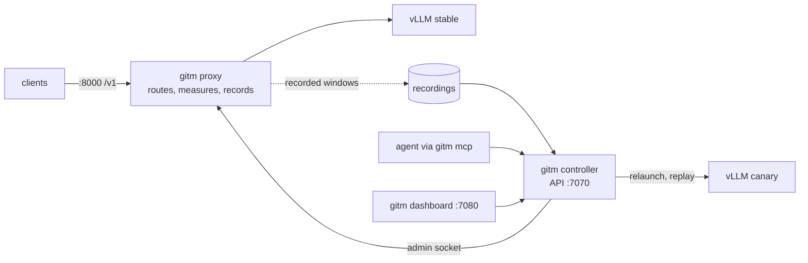
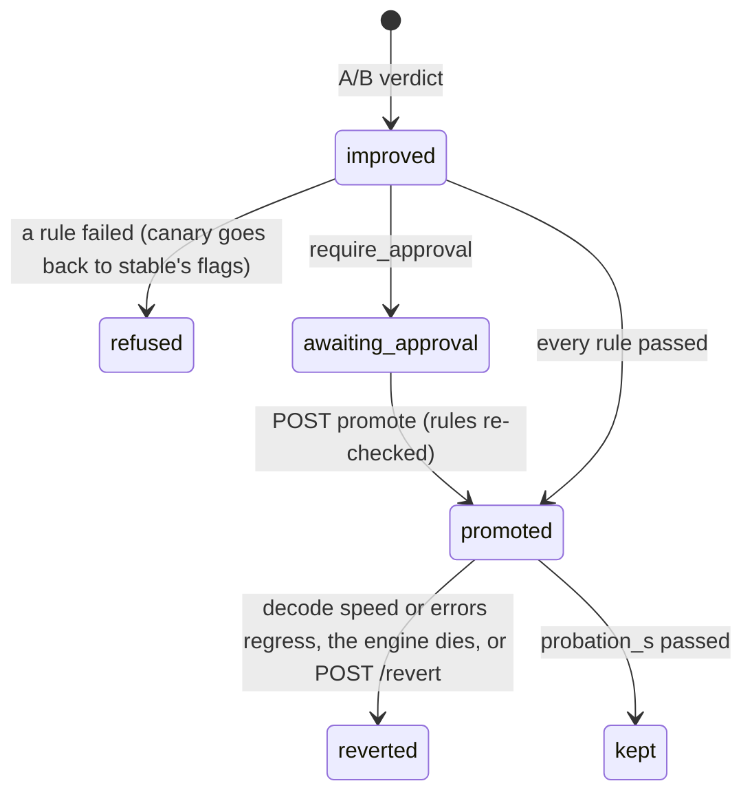

# The gitm server

This page covers `gitm run --server`: gitm running beside a real `vllm serve` deployment instead of as a batch job. It explains what runs where, how a change is tested and promoted, every rule a promotion has to pass, and the known limits. It's for engineers who operate the server, connect an agent or the dashboard to it, or change it. The code is in `gitm/server/` and `gitm/dashboard/`.

## In one paragraph

`gitm run --server` launches two `vllm serve` engines and puts gitm's own OpenAI-compatible proxy in front of them:
- The **stable** engine serves every client request.
- The **canary** engine is where changes are tested.

The proxy records the shape of the traffic it serves: arrival times, token counts and shared prefixes, but never prompt text. A change ("intervention") is an A/B test that runs entirely on the canary. The stable configuration and the candidate take turns on the canary, and each replays the same recorded traffic. If the candidate wins and every promotion rule passes, gitm reroutes traffic to the canary: by itself in autonomous mode, after approval otherwise. The old engine stays loaded through a probation period, which makes a revert instant, and is shut down when probation passes. An agent drives all of this through MCP, and a person through the dashboard.



## Quick start (laptop, one GPU)

```bash
gitm run --server --model Qwen/Qwen2.5-0.5B-Instruct --mem-fraction 0.4 \
  --serve-args "--max-model-len 8192" --scratch ~/.cache/gitm-server
gitm dashboard                                   # then paste the URL and <scratch>/api-token
gitm mcp --token-file ~/.cache/gitm-server/api-token    # for an MCP client, over stdio
```

Point clients at `http://127.0.0.1:8000/v1` exactly as they would point them at vLLM.

## Processes, and why they are separate

| Process | What it does | If it dies |
|---|---|---|
| **proxy** (`python -m gitm.server.proxy`) | The only gitm code on a request's path. It forwards the OpenAI endpoints with streaming, measures time to first token (TTFT), latency and token counts, and records each request after it completes. It switches the upstream engine atomically, draining in-flight requests first. | Clients lose the endpoint, so it is kept small. |
| **engines** (`vllm serve`, one each) | Serve or test. Each has its own environment, port, GPUs and log. | The proxy returns 502 for that engine. During probation, a dead promoted engine triggers a revert. |
| **controller** (the `gitm run --server` process) | Runs the API, tests, promotion rules, probation, state file and audit log. | Nothing stops serving. The proxy and engines run in their own sessions, so traffic keeps flowing to the last stable engine (fail-open). |

Ctrl-C on `gitm run --server` is a clean stop. It stops the proxy first, then every engine the server started.

## Recording

- Each completed request becomes one Mooncake-shaped JSONL row in `<scratch>/recordings/window-*.jsonl`, holding `timestamp`, `input_length`, `output_length` and `hash_ids`. `gitm.traffic.adapters.read_mooncake` reads these back unchanged.
- **Token counts** come from the engine's own `usage`. For streamed requests the proxy asks for `stream_options.include_usage`, and removes the usage-only chunk when the client didn't ask for it.
- **Prefix identity** is a chain of hashes over 512-token blocks of the prompt's token ids, taken from the engine's own `/tokenize`. This happens after the response, off the request path. Two requests share a block id only when they share the entire prefix up to and including that block.
- **Each window is rewritten in arrival order when it closes.** Rows are written as requests finish, so a long request that arrived first would otherwise sit after shorter ones, and the trace reader drops rows that go back in time.
- **A window closes once it holds `min_window_requests` and is `traffic_window_s` old**, so low-rate traffic still produces windows that can be judged.
- **No prompt text is stored.** If the tokens can't be read, the request is recorded with private block ids. That under-counts sharing rather than inventing it.

## Testing a change

Submit a change with `POST /interventions {"knobs": {"max_num_batched_tokens": 16384}}`, through the dashboard, or with the MCP tool `start_intervention`.

**Refused up front:**
- the server has no canary;
- stable already runs that value, judged by its flags or by the configuration the engine itself resolved and logged;
- vLLM's own argument parser rejects the flags;
- there isn't yet a recorded window with at least `min_window_requests` requests.

**How a test runs** (`gitm/server/canary.py`):
1. The newest recorded window that is big enough is chosen and capped at `max_replay_requests`.
   - `replay_speed` > 1 compresses arrivals, which tests at a higher load than was recorded.
2. The A/B runs entirely on the canary in ABBA order with paired samples:
   - **arm A** is stable's own flags; **arm B** is the candidate;
   - every arm switch relaunches the canary;
   - each sample starts from an empty prefix cache and is one `vllm bench serve` replay of the window.
3. **Correctness:** fixed probe sequences (four prompts plus the baseline arm's greedy continuation) are run teacher-forced on each arm. Their top-1 tokens are compared position by position, and must agree on at least `min_correctness` of positions (0.95).
4. **Stable measurements only.** With `settle_s` > 0, the sampler waits that long before each sample. If either arm's own samples of the primary metric spread more than `max_arm_spread` (15%), an improved or regressed verdict becomes **unstable**: the machine moved, so neither verdict can be trusted, and nothing is promoted.
5. **The verdict** comes from `gitm.experiment.evaluate`: improved, regressed, inconclusive, invalid or failed_to_execute. It applies latency gates on p99 TTFT and p99 inter-token latency (ITL), and uses a paired t-interval on the primary metric.
6. **Primary metric:** `mean_tpot_ms` (time per output token). A replay offers the load the trace recorded, so below saturation every configuration serves the same tokens per second; only latency tells them apart.

The stable engine is never measured by a replay, so production is never disturbed.

## Promotion rules

After an `improved` verdict, the controller evaluates every rule. If all pass, autonomous mode promotes; manual and assisted wait for `POST /interventions/{id}/promote` (as does autonomous with `require_approval`). Each rule's result and evidence is stored with the intervention (`GET /interventions/{id}/rules`). Approval re-checks every rule; it skips none.

| Group | Rule | Passes when |
|---|---|---|
| evidence | `verdict_improved` | the verdict is `improved` |
| | `enough_rounds` | at least `promote_min_rounds` candidate samples |
| | `clears_noise` | the interval's lower bound is above max(`min_effect`, `noise_factor` × the baseline arm's own relative spread) |
| | `correctness`, `latency_gates` | both passed in the verdict |
| | `no_failed_requests` | every replay request completed |
| | `verdict_recent` | the verdict is younger than `max_verdict_age_s` |
| | `isolated_measurement` | the canary has its own GPUs, or stable served ≤ `max_shared_gpu_stable_rps` during every sample |
| traffic | `traffic_unchanged` | the tested window's regime is within `max_regime_distance` (log2 units) of the newest window's |
| hardware | `same_capacity` | the canary has stable's GPU count and memory fraction |
| | `canary_ready` | the canary is up and running the candidate |
| operator | `not_paused`, `not_frozen` | not paused; not inside a `freeze_hours_utc` window |
| | `knobs_allowed` | passes the `allow_knobs` and `deny_knobs` globs |
| | `not_reverted_before` | this exact change was never reverted |
| | `promotion_interval`, `revert_cooldown` | enough time has passed since the last promotion and since the last revert |

## Swap, probation, revert



- **Promote:** the proxy routes to the canary and the old engine drains. The old engine then becomes `standby`, still loaded.
- **Probation:** every `probation_interval_s`, the median per-request decode speed (tokens per second after the first token) is compared with what the old engine achieved in the five minutes before the swap. The comparison uses an `AutoRevert` window, with a `probation_tolerance` drop allowed. If the error rate goes above `probation_max_error_rate`, gitm reverts at once.
- **Revert:** the proxy routes back to the standby engine. The change is recorded as reverted, which blocks it from then on, and the canary is put back on stable's flags.
- **Kept:** the old engine is stopped, and its slot is relaunched as the new canary on the new stable flags.

State is kept in `<scratch>/state.json`: promotions, reverts and their timings. Every change is appended to `<scratch>/audit.jsonl`.

## Modes: who decides what is tested and what goes live

The operator chooses (`gitm/server/autonomy.py`):

| Mode | What gitm does |
|---|---|
| **manual** (no session) | Tests only what someone queues. A win waits for approval. |
| **assisted** | Also picks candidates itself. Every win still waits for approval. |
| **autonomous** | Picks, tests and promotes by itself, within every promotion rule. |

Assisted and autonomous run as a **session**, started with `POST /autonomy/start` or the dashboard's Mode panel. Its limits:

- **Budget:** `budget_h` hours and/or `max_tests` tests gitm may start on its own. When either is spent, the server goes back to manual. Tests a person queues don't count against it.
- **Schedule:** local `[start_hour, end_hour]` windows in which gitm may *start* its own tests; windows may wrap midnight. Its queued picks wait outside them, and are skipped over, so a hand-queued test behind them still runs.
- **Scope:** `allow_knobs`, `deny_knobs` and `tiers`. These only narrow the policy.

`POST /autonomy/stop` returns to manual. Stable is left as it is, and gitm's own queued picks are dropped. With `cancel_current`, a test gitm started is cancelled too; otherwise it finishes. `require_approval` in the policy makes even autonomous mode wait for a person.

## The queue

Tests run in queue order: `GET /queue`, `POST /queue/{id}/move` (0 = next), `POST /queue/{id}/front`, and `POST /interventions/{id}/stop` to remove one. `POST /interventions` takes `"front": true` to jump the queue. Each item says if it's waiting, and why.

## Picking candidates

In a session, whenever nothing is queued, the controller takes the next candidate from gitm's lever catalogue (`gitm/server/explore.py`); `GET /explore/preview` shows the order. Candidates are filtered:
- by risk tier and the session's scope;
- to serve flags only;
- with no placement knobs;
- to levers for something this model actually has, according to its HF config: MoE levers need experts, and multi-GPU levers need TP > 1;
- to values stable doesn't already run, judged by its flags and by the configuration the engine itself resolved;
- to changes not yet tried **against this stable configuration on traffic like the current traffic**, and not reverted on traffic like it.

Every candidate still goes through the full A/B and every rule.

## Traffic changes

A result is about the traffic it was measured on (`gitm/server/traffic.py`). Every test stores the **regime** of the window it replayed: rate, prompt and answer lengths, prompt-to-answer ratio and burstiness, at real speed.

- **The watcher** closes the open recording window every `traffic_window_s`, reads each new window's regime every `traffic_check_s`, and compares it with the regime stable was tuned for. That's the first traffic seen, then the traffic of each promoted change. Past `traffic_change_distance` (log2 units: 1.0 means some axis changed 2×), traffic has **changed**. `GET /traffic/watch` and the dashboard's Traffic panel show both regimes and the distance.
- **"Tried" is per traffic.** On new traffic, earlier results no longer count as tried, so changes become candidates again.
- **On a change, in a session,** gitm queues, in order:
  1. a **re-check**: the last promoted change reversed, to see whether it still beats what it replaced;
  2. changes already **proven** on traffic like the new one;
  3. changes that won or nearly won on the **old** traffic.

  Then the explorer continues. In manual mode the change is only reported.
- `POST /traffic/retune` accepts the current traffic as the new normal, without re-testing.

The memory survives restarts: finished interventions are reloaded from `<scratch>/interventions/`. The coordinates are those of `gitm.playbook.match.regime_distance`, so a result can become a playbook row unchanged.

## API

All routes need `Authorization: Bearer <scratch>/api-token`.

| | |
|---|---|
| `GET /status`, `/engines`, `/stats?window_s=`, `/events`, `/recordings`, `/policy`, `/promotions` | read |
| `POST /interventions`, `GET /interventions[/{id}]`, `POST /interventions/{id}/stop` | tests |
| `GET /interventions/{id}/rules`, `POST /interventions/{id}/promote`, `POST /revert` | promotion |
| `POST /pause`, `/resume`, `PUT /policy` | operator |
| `GET /autonomy`, `POST /autonomy/start`, `POST /autonomy/stop`, `GET /explore/preview` | modes |
| `GET /queue`, `POST /queue/{id}/move`, `POST /queue/{id}/front` | queue |
| `GET /traffic/watch`, `POST /traffic/retune` | traffic changes |
| `GET /traffic/presets`, `POST /traffic/simulate`, `GET /traffic`, `POST /traffic/{id}/stop` | simulated traffic |

`gitm mcp` exposes the same controls as 18 MCP tools. CORS admits only the dashboard's origin (`dashboard_origins`).

## Known limits

- **One shared GPU.** With stable and canary on the same GPU, stable's production load competes with the canary's measurement. On an RTX 4050, about 1 request per second of live traffic turned CUDA graphs' +21% into +2% (interval −16% to +21%). `isolated_measurement` refuses such results, so on a shared GPU, tests are only promotable while production is quiet. Give the canary its own GPUs (`--stable-gpus 0,1,2,3 --canary-gpus 4,5,6,7`) to remove the limit.
- **Laptop CPUs throttle.** On the RTX 4050 laptop, a replay started straight after another ran 2× slower: the CPU reached 96°C and firmware held it near 450 MHz while the GPU clock never moved. Set `settle_s: 45` on a laptop; the unstable check catches what remains.
- **Replays carry shape, not text.** Lengths, timing and prefix sharing are reproduced; content is not. Speculative decoding depends on content, so it can't be judged on a replay.
- **Every structural change is a canary relaunch.** That's seconds on a small model and minutes on Kimi.
- **A controller restart does not adopt running engines.** `state.json` (promotions, reverts, the session, the tuned-for traffic) and the results memory survive, but the restarted controller launches fresh engines, and tests that were queued are marked stopped.
- **A traffic change is judged on lengths, ratio and burstiness, not request rate:** the playbook's distance leaves rate out on purpose. Load changes are what the latency gates and the noise check see.
